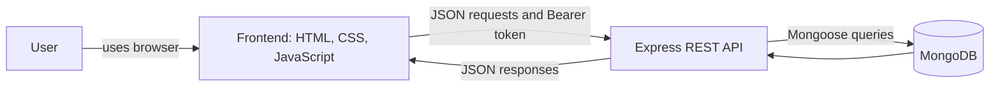

# MINI PROJECT REPORT

## Student Result Management System

Submitted in partial fulfillment of the requirements for the Full Stack Development Mini Project.

| Student detail | Enter before submission |
| --- | --- |
| Student name | ______________________________ |
| Roll number | ______________________________ |
| Class / division | ______________________________ |
| Project title | Student Result Management System |

## 1. Project Overview

### 1.1 Problem Statement

Recording marks in separate notebooks or spreadsheets makes it harder to find a student's result, recalculate totals, and compare performance across a class. Manual calculations can also lead to inconsistent totals. This project provides a browser-based place to enter and maintain student marks in Physics, Chemistry, and English. It calculates totals and averages automatically and ranks records by total marks. Users sign in to a private workspace so one account cannot view or edit another account's results. The application uses a web interface, a REST API, and MongoDB to store the records.

### 1.2 Objectives

- Build a complete web application with a frontend, backend API, and database.
- Provide account registration and sign-in with hashed passwords.
- Store and manage student marks for three subjects.
- Calculate totals and averages consistently on the server.
- Support viewing, searching, adding, updating, and deleting student records.
- Display class size, average marks, and the highest scoring student.
- Validate input and restrict records to the account that created them.

### 1.3 Technology Stack

| Area | Technology |
| --- | --- |
| Frontend | HTML, CSS, JavaScript |
| Backend | Node.js, Express.js |
| Database | MongoDB, Mongoose |
| API / communication | JSON REST API over HTTP; Bearer token for protected routes |
| Tools | Visual Studio Code, Git, GitHub, MongoDB; Postman can be used for API checks |

## 2. System Design

### 2.1 System Architecture / Workflow

The browser sends JSON requests to the Express server. Registration and login return a signed session token. Protected student routes validate that token and include the account ID in database queries. MongoDB stores account and result documents. The server also serves the frontend files, so the local project uses one web address.

### 2.2 Main Modules / Features

| Sr. No. | Module / Feature | Short Description |
| --- | --- | --- |
| 1 | Account access | Register and sign in; passwords are stored as bcrypt hashes. |
| 2 | Student results | Add, view, update, and delete student result records. |
| 3 | Marks and ranking | Validate subject marks, calculate total and average, and sort by total. |
| 4 | Search and summary | Search names and show class count, average, and top performer. |

### 2.3 Database Design

**users collection**

| Field | Type | Purpose |
| --- | --- | --- |
| `_id` | ObjectId | Account identifier |
| `name` | String | Account holder name |
| `email` | String | Unique, normalized sign-in email |
| `passwordHash` | String | bcrypt password hash; excluded from normal queries |
| `createdAt`, `updatedAt` | Date | Mongoose timestamps |

**students collection**

| Field | Type | Purpose |
| --- | --- | --- |
| `_id` | ObjectId | Result record identifier |
| `owner` | ObjectId reference to User | Account that owns the result |
| `name` | String | Student name |
| `physics`, `chemistry`, `english` | Number | Whole-number marks from 0 to 100 |
| `total` | Number | Sum of the three subject marks, maximum 300 |
| `average` | Number | Mean subject mark, rounded to one decimal place |
| `createdAt`, `updatedAt` | Date | Mongoose timestamps |

### 2.4 API Endpoints

| Method | Endpoint | Description |
| --- | --- | --- |
| GET | `/api/health` | Reports API and database state |
| POST | `/api/auth/register` | Creates an account and returns a token |
| POST | `/api/auth/login` | Checks credentials and returns a token |
| GET | `/api/auth/me` | Returns the current account |
| GET / POST | `/api/students` | List or add results for the signed-in account |
| PUT / DELETE | `/api/students/:id` | Update or remove an owned result |

## 3. Implementation and Results

### 3.1 Implementation Summary

The frontend is written in HTML, CSS, and browser JavaScript. It provides sign-in and registration forms plus a results dashboard. JavaScript sends JSON requests to the Express API and includes the signed-in token on student requests. The server validates input, hashes passwords with bcrypt, signs session tokens, and uses Mongoose to read and write MongoDB documents. Each result query includes the signed-in account ID. Subject marks are validated on both the browser and server, and the server calculates the total and average. The frontend displays ranked records, filters them by student name, and refreshes the class summary after changes.

### 3.2 Output Screenshots

Add screenshots captured from your running application. Use real records with no private or sensitive information.

**Screenshot 1: Sign-in / registration page**

_Paste a screenshot here after starting the project._

**Screenshot 2: Results dashboard with sample student records**

_Paste a screenshot here after adding sample records._

### 3.3 Testing / Result

Run these checks locally and replace each “To run” entry with the actual result. Do not mark a check as passed until you have performed it.

| Feature tested | Expected result | Status |
| --- | --- | --- |
| Account registration and sign-in | A valid account can register and sign in; invalid credentials are rejected. | To run |
| Student result creation and calculation | Valid subject marks save with the correct total and average. | To run |
| Validation and record ownership | Out-of-range marks are rejected and one account cannot access another account's records. | To run |
| Search, update, and delete | Search filters names; edits persist; deleted records disappear. | To run |
| Health endpoint | `/api/health` reports the connected database. | To run |

### Local setup for the report demonstration

1. Start MongoDB or configure a MongoDB Atlas URI.
2. Copy `backend/.env.example` to `backend/.env` and set `MONGO_URI` and a random `JWT_SECRET` of at least 32 characters.
3. Run `npm install` and `npm start` from the `backend` directory.
4. Open `http://localhost:5000`, register an account, add sample students, and capture the screenshots above.

## 4. Conclusion

The Student Result Management System demonstrates how a web interface, REST API, and MongoDB can work together to manage academic records. It reduces repeated manual calculations by deriving totals and averages from validated subject marks. Account-based access keeps each user's records separated. The project can be extended with additional subjects, exam terms, downloadable reports, and role-based accounts for teachers and administrators.

## Reference

This project was developed from the supplied student marks calculator and static login/signup examples in the original repository: [arati8846/aarti](https://github.com/arati8846/aarti).
